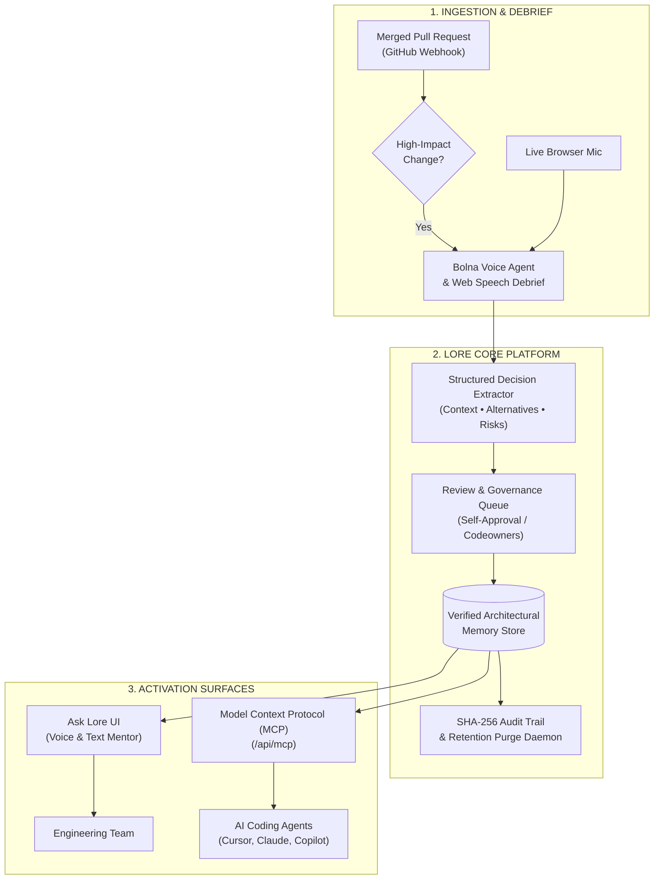

# Lore — Enterprise Voice Assistant & Architectural Memory

<p align="center">
  
</p>

<p align="center">
  <strong>The verified "why" behind your code changes — for engineers and their coding agents.</strong>
</p>

<p align="center">
  <a href="#key-features">Key Features</a> •
  <a href="#system-architecture">Architecture</a> •
  <a href="#quickstart">Quickstart</a> •
  <a href="#model-context-protocol-mcp">Coding Agent MCP</a> •
  <a href="#api-reference">API Reference</a> •
  <a href="#security--governance">Security</a>
</p>

---

## Overview

Modern software teams produce thousands of pull requests, commits, and tickets, yet the **critical architectural reasoning** behind those decisions is often lost:
- *Why was a specific pattern chosen over standard framework defaults?*
- *What alternatives were evaluated, tested, and rejected?*
- *Under what operational conditions or scale thresholds does this logic invalidate?*

**Lore** transforms institutional tacit knowledge into structured, permanent, and accessible decision records. Using high-bandwidth **voice debriefs**, Lore extracts the "why" directly from authors at the moment of change, indexes the rationale with strict provenance, and makes it queryable for both **human developers** (via voice and text) and **autonomous coding agents** (via the Model Context Protocol).

Built for the **[Bolna Symphony Buildathon](https://www.bolna.ai/symphony/buildathon)** and aligned with the enterprise **"Company Brain"** architectural thesis.

---

## Key Features

### 1. Voice-First Capture Studio
- **Adaptive Voice Debriefs**: Engineers conduct 2-3 minute structured debriefs answering targeted architectural questions (Context, Rejected Alternatives, Failure Modes).
- **Bolna Symphony Integration**: Telephony and web voice agent capabilities for automated post-merge engineer outreach.
- **Live In-Browser Speech Recognition**: Instant speech-to-text with real-time waveform visualization, requiring zero external software.

### 2. Grounded AI Mentor ("Ask Lore")
- **Evidence-Based Grounding**: Every answer is synthesized directly from verified architectural decision records with interactive citation badges (`[1]`, `[2]`).
- **Voice In, Voice Out**: Tap the microphone, speak an engineering question aloud, and listen to Lore read the verified rationale back in natural speech.
- **Honest Abstention State**: Rather than hallucinating or guessing on unknown topics, Lore explicitly abstains and surfaces the closest verified team records.
- **Interactive Source Drawer**: One-click inspection of cited PRs, authors, verified dates, and source audio transcripts.

### 3. Model Context Protocol (MCP) for Coding Agents
- **Trust Layer for AI Agents**: Native read-only MCP server (`/api/mcp`) implementing JSON-RPC 2.0.
- **IDE & Agent Integration**: Allows Cursor, Claude Code, GitHub Copilot, and Antigravity to retrieve verified decisions before executing refactors or editing legacy systems.

### 4. Automated PR Debrief Trigger Engine
- **GitHub Webhook Analysis**: Evaluates merged pull requests based on impact, changed lines, and critical service boundaries to prompt authors for change debriefs.
- **Self-Approval & Review Gates**: Streamlined approval workflows supporting author self-approval for standard updates and multi-reviewer sign-offs for mission-critical services.

### 5. Enterprise Governance & Reliability
- **Zero-Knowledge Boundaries**: Strict guardrails preventing credential, secret, or private token exposure.
- **Regulatory Compliance**: Audio buffer purge workflows compliant with DPDP and GDPR minimal retention guidelines.
- **Cryptographic Audit Trail**: Immutable SHA-256 verified event logging across decision approvals, retention cycles, and agent queries.
- **Automated Numeric Eval Gates**: Continuous evaluation suite testing citation correctness, abstention on unknowns, and zero permission leakage.

---

## System Architecture



---

## Tech Stack

| Layer | Technologies |
| :--- | :--- |
| **Frontend Framework** | [Next.js 14](https://nextjs.org/) (App Router, React 18, TypeScript) |
| **Styling & Design System** | [Tailwind CSS](https://tailwindcss.com/), Framer Motion, Lucide Icons |
| **Voice & Speech Engine** | [Bolna Symphony](https://www.bolna.ai/), Web Speech Recognition, Web SpeechSynthesis API |
| **Protocol Standards** | Model Context Protocol (MCP) JSON-RPC 2.0, GitHub Webhooks v3 |
| **Security & Governance** | SHA-256 Audit Logging, Zero-Knowledge Secret Guardrails, Minimal Audio Retention |

---

## Quickstart

### Prerequisites
- [Node.js](https://nodejs.org/) v18.18 or higher (v20+ recommended)
- `npm` or `pnpm`

### 1. Clone & Install Dependencies
```bash
git clone https://github.com/UtkarshGhom/Lore-enterprise-voice-assistant.git
cd Lore-enterprise-voice-assistant
npm install
```

### 2. Configure Environment Variables
Copy `.env.example` to `.env.local`:
```bash
cp .env.example .env.local
```

Configure your credentials:
```env
# Bolna Symphony Voice Agent
BOLNA_API_KEY=your_bolna_api_key_here
BOLNA_AGENT_ID=your_bolna_agent_id_here
BOLNA_WEBHOOK_SECRET=your_bolna_webhook_secret_here

# App URL for webhooks
NEXT_PUBLIC_APP_URL=http://localhost:3000
```

### 3. Run Development Server
```bash
npm run dev
```

Open [http://localhost:3000](http://localhost:3000) in your browser.

### 4. Build for Production
```bash
npm run build
npm run start
```

---

## Model Context Protocol (MCP)

Lore exposes a standard Model Context Protocol endpoint for AI coding assistants.

### Available Tools
1. **`get_verified_decision`**: Retrieves verified decision rationale, rejected alternatives, and edge-case caveats for a target system, file, or keyword.
2. **`query_architectural_rationale`**: Queries institutional decisions before refactoring legacy components.

### Connecting to Coding Agents (Cursor / Claude Code)
Add the Lore MCP endpoint to your client configuration:
```json
{
  "mcpServers": {
    "lore": {
      "url": "http://localhost:3000/api/mcp"
    }
  }
}
```

---

## API Reference

| Endpoint | Method | Description |
| :--- | :---: | :--- |
| `/api/mcp` | `GET` / `POST` | Model Context Protocol JSON-RPC 2.0 server (`tools/list`, `tools/call`) |
| `/api/github/webhook` | `POST` | Receives PR merge events and detects architectural rationale gaps |
| `/api/eval` | `GET` | Executes automated reliability gates (citations, abstention, guardrails) |
| `/api/audit` | `GET` / `POST` | Queries and appends to the immutable SHA-256 governance audit trail |

---

## Security & Governance

- **Zero-Knowledge Architecture**: Inaccessible records and private credentials never enter model prompts or retrieval contexts.
- **Minimal Retention Workflow**: Raw audio streams are scheduled for automated purge post-transcription in compliance with DPDP and GDPR requirements, preserving only verified, signed-off text records.
- **Traceable Provenance**: Every architectural decision maintains strict linkage to its originating pull request, author identity, and verification date.

---

## License

This project is licensed under the [MIT License](LICENSE).
